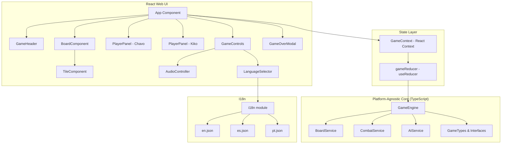
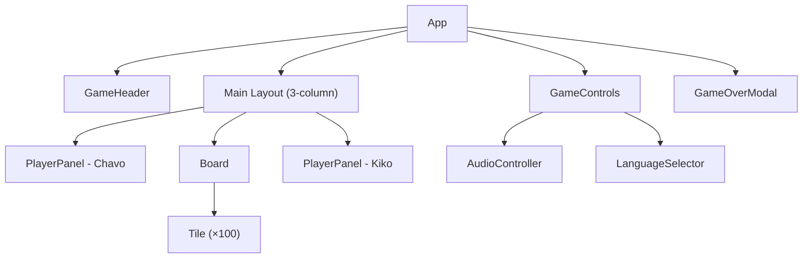
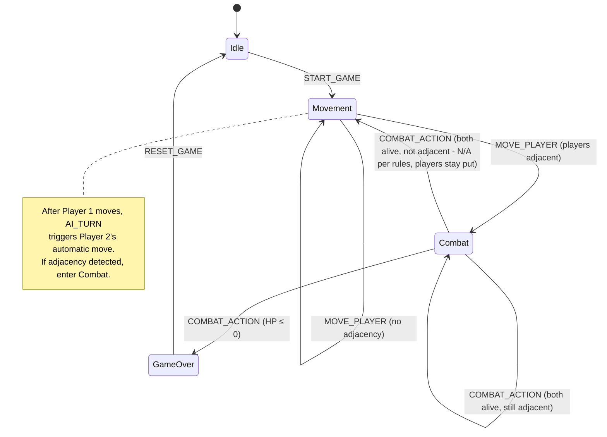

# Technical Design Document: Game Modernization

## Overview

This design describes the modernization of the "Chavo del Ocho" board game from a legacy jQuery/Bootstrap 4 monolith into a modular React + Vite application. The existing game is a single-player, turn-based 10×10 grid board game where Player 1 (Chavo, human) competes against Player 2 (Kiko, AI). Players move up to 3 tiles in cardinal directions, collect weapons, and engage in attack/defend combat when adjacent.

The modernization preserves all existing game mechanics and assets while introducing:
- A React component architecture with clear separation between game logic and UI
- Platform-agnostic game engine (pure TypeScript, no DOM dependencies) to enable future React Native reuse
- Centralized state management via React Context + `useReducer`
- CSS Modules for scoped styling (replacing Bootstrap)
- Structured i18n with key-value resource files (EN/ES/PT)
- Vite as the build system with HMR for development

The architecture is designed so the core game engine can be shared with a future React Native app and a future remote multiplayer mode without modification.

## Architecture



### Key Architectural Decisions

1. **Platform-agnostic core**: All game logic lives in pure TypeScript modules with zero DOM/React imports. This satisfies Requirement 14 (React Native roadmap) and Requirement 15 (multiplayer roadmap) by ensuring the engine can be consumed by any UI layer or network transport.

2. **React Context + useReducer over Redux**: The game state is relatively simple (single game session, no server sync yet). `useReducer` provides predictable state transitions via a reducer pattern without adding a heavy dependency. The reducer dispatches to the `GameEngine` for all state mutations, keeping the React layer thin.

3. **CSS Modules over Tailwind/styled-components**: CSS Modules provide scoped class names with zero runtime cost, work well with Vite, and keep styling familiar for developers coming from plain CSS. The existing visual patterns (grid layout, tile backgrounds) map naturally to CSS Modules.

4. **Vite**: Fast HMR, native ESM, optimized production builds. Aligns with Requirement 1.

### Project Structure

```
src/
├── engine/                  # Platform-agnostic game logic (no DOM/React)
│   ├── types.ts             # All game types and interfaces
│   ├── GameEngine.ts        # Main engine: orchestrates board, combat, turns
│   ├── BoardService.ts      # Board generation, movement validation, pathfinding
│   ├── CombatService.ts     # Combat resolution logic
│   └── AIService.ts         # AI opponent decision-making
├── components/              # React UI components
│   ├── App.tsx
│   ├── App.module.css
│   ├── Board.tsx
│   ├── Board.module.css
│   ├── Tile.tsx
│   ├── Tile.module.css
│   ├── PlayerPanel.tsx
│   ├── PlayerPanel.module.css
│   ├── GameHeader.tsx
│   ├── GameHeader.module.css
│   ├── GameControls.tsx
│   ├── GameControls.module.css
│   ├── GameOverModal.tsx
│   ├── GameOverModal.module.css
│   ├── AudioController.tsx
│   └── LanguageSelector.tsx
├── state/                   # State management
│   ├── GameContext.tsx       # React Context provider
│   ├── gameReducer.ts       # Reducer (dispatches to GameEngine)
│   └── actions.ts           # Action type definitions
├── i18n/                    # Internationalization
│   ├── index.ts             # i18n utility functions
│   ├── en.json
│   ├── es.json
│   └── pt.json
├── assets/                  # Static assets (images, audio)
├── main.tsx                 # Entry point
└── index.html
```

## Components and Interfaces

### Platform-Agnostic Engine Components

#### GameEngine
The central orchestrator. Exposes pure functions that take the current `GameState` and an action, and return a new `GameState`. No side effects, no DOM access.

Key methods:
- `initializeGame(): GameState` — generates board, places entities, assigns starting weapons
- `processMove(state: GameState, targetTile: Position): GameState` — validates and executes a move, handles weapon pickup, checks adjacency
- `processCombatAction(state: GameState, action: CombatAction): GameState` — resolves combat round
- `getValidMoves(state: GameState): Position[]` — returns highlighted tiles for the active player
- `getAIMove(state: GameState): Position` — delegates to AIService for Player 2's move
- `getAICombatAction(state: GameState): CombatAction` — delegates to AIService for Player 2's combat choice

#### BoardService
Handles board generation and spatial queries.

- `generateBoard(gridSize: number, obstacleCount: number, weapons: WeaponDefinition[]): BoardState` — creates the initial board with random placement of obstacles, weapons, and players ensuring no overlaps
- `getValidMovesForPlayer(board: BoardState, playerPosition: Position, maxRange: number): Position[]` — calculates valid movement tiles (up to 3 in each cardinal direction, blocked by obstacles and other players)
- `areAdjacent(a: Position, b: Position): boolean` — checks horizontal/vertical adjacency
- `getTileAt(board: BoardState, position: Position): Tile` — returns tile info at a position

#### CombatService
Pure combat resolution.

- `resolveCombat(attacker: CombatAction, defender: CombatAction, attackerWeapon: Weapon, defenderWeapon: Weapon): CombatResult` — returns HP deltas based on attack/defend combinations
- `checkWinCondition(player1HP: number, player2HP: number): WinResult | null` — returns winner if any player's HP ≤ 0

#### AIService
AI decision-making for Player 2.

- `chooseMove(state: GameState): Position` — selects a valid tile for Player 2 (strategy: move toward weapons or toward Player 1)
- `chooseCombatAction(state: GameState): CombatAction` — selects attack or defend for Player 2

### React UI Components

#### App
Root component. Wraps everything in `GameProvider` (context) and `I18nProvider`. Renders the three-column layout: PlayerPanel (Chavo) | Board | PlayerPanel (Kiko), with GameHeader above and GameControls below.

#### Board
Renders the 10×10 grid of `Tile` components. Receives board state from context. Passes click handlers for movement.

#### Tile
Renders a single grid cell. Displays the appropriate image based on tile contents (player, weapon, obstacle, empty). Applies highlight styling when the tile is a valid move target. Handles click events for player movement.

#### PlayerPanel
Displays a player's info: animated GIF, HP bar, current weapon image, damage value. For Player 1, shows Attack/Defend buttons during combat. For Player 2, shows AI status text. Visually distinguishes the active player with a border/glow effect.

#### GameHeader
Displays the game title (translated) and a turn indicator showing whose turn it is.

#### GameControls
Contains the "Start Game" button and the `AudioController` and `LanguageSelector` sub-components.

#### AudioController
Manages background music playback (play/pause/volume) using the HTML5 Audio API. References existing audio assets.

#### LanguageSelector
Three buttons (EN/ES/PT) that switch the active locale. Updates all translated strings via the i18n context.

#### GameOverModal
Overlay displayed when a player wins. Shows the winner's name/image and a "Play Again" button.

### Component Hierarchy



## Data Models

### Core Types (src/engine/types.ts)

```typescript
// Board position
interface Position {
  x: number; // 0-9
  y: number; // 0-9
}

// Weapon definitions
interface WeaponDefinition {
  id: string;         // 'torta' | 'supertorta' | 'slingshot' | 'ramon' | 'barriga'
  name: string;       // Display name (i18n key)
  damage: number;     // 15 | 25 | 30 | 35 | 20
  image: string;      // Path to image asset
}

// Tile contents
type TileContent =
  | { type: 'empty' }
  | { type: 'obstacle' }
  | { type: 'weapon'; weapon: WeaponDefinition }
  | { type: 'player'; playerId: PlayerId };

// Tile in the grid
interface Tile {
  position: Position;
  content: TileContent;
}

type PlayerId = 'player1' | 'player2';

// Player state
interface PlayerState {
  id: PlayerId;
  position: Position;
  hp: number;           // 0-100
  weapon: WeaponDefinition;
  combatAction: CombatAction | null;
}

type CombatAction = 'attack' | 'defend';

// Board state (the grid)
interface BoardState {
  gridSize: number;     // 10
  tiles: Tile[][];      // 10×10 matrix
}

// Game phase
type GamePhase =
  | 'idle'              // Before game starts
  | 'movement'          // Active player choosing a move
  | 'combat'            // Players are adjacent, choosing actions
  | 'gameOver';         // A player has won

// Complete game state
interface GameState {
  board: BoardState;
  players: Record<PlayerId, PlayerState>;
  activePlayer: PlayerId;
  phase: GamePhase;
  winner: PlayerId | null;
  validMoves: Position[];  // Computed for current active player
}

// Combat resolution result
interface CombatResult {
  player1HPDelta: number;
  player2HPDelta: number;
}

// Win check result
interface WinResult {
  winner: PlayerId;
  loser: PlayerId;
}

// Reducer actions
type GameAction =
  | { type: 'START_GAME' }
  | { type: 'MOVE_PLAYER'; position: Position }
  | { type: 'COMBAT_ACTION'; action: CombatAction }
  | { type: 'AI_TURN' }
  | { type: 'RESET_GAME' };
```

### Weapon Definitions (Constants)

```typescript
const WEAPONS: WeaponDefinition[] = [
  { id: 'torta',      name: 'weapon.torta',      damage: 15, image: '/images/torta.png' },
  { id: 'supertorta', name: 'weapon.supertorta',  damage: 25, image: '/images/supertorta.png' },
  { id: 'slingshot',  name: 'weapon.slingshot',   damage: 30, image: '/images/resortera.png' },
  { id: 'ramon',      name: 'weapon.ramon',       damage: 35, image: '/images/ramon_static.png' },
  { id: 'barriga',    name: 'weapon.barriga',     damage: 20, image: '/images/barriga.png' },
];
```

### I18n Resource Structure (e.g., en.json)

```json
{
  "game.title": "Chavo del Ocho - Board Game",
  "game.start": "Start Game",
  "game.turn": "{{player}}'s Turn",
  "game.over": "{{player}} Wins!",
  "game.playAgain": "Play Again",
  "player.player1": "Chavo",
  "player.player2": "Kiko",
  "player.life": "Life",
  "player.weapon": "Weapon",
  "player.damage": "Damage",
  "combat.attack": "Attack",
  "combat.defend": "Defend",
  "combat.aiThinking": "AI is thinking...",
  "weapon.torta": "Torta",
  "weapon.supertorta": "Supertorta",
  "weapon.slingshot": "Slingshot",
  "weapon.ramon": "Don Ramón",
  "weapon.barriga": "Mr. Barriga",
  "audio.play": "Play",
  "audio.pause": "Pause",
  "lang.en": "English",
  "lang.es": "Español",
  "lang.pt": "Português"
}
```

### State Flow




## Correctness Properties

*A property is a characteristic or behavior that should hold true across all valid executions of a system — essentially, a formal statement about what the system should do. Properties serve as the bridge between human-readable specifications and machine-verifiable correctness guarantees.*

### Property 1: Board generation produces a valid initial state

*For any* random seed, when a new game is initialized, the resulting board state SHALL have exactly 100 tiles in a 10×10 grid, exactly 12 obstacles, exactly 5 weapons (one of each type), exactly 2 players at distinct positions, each player assigned a weapon from the valid set, and no two entities occupying the same tile.

**Validates: Requirements 3.1, 3.4, 4.1, 4.2, 4.3, 4.4, 4.5, 6.3**

### Property 2: Valid moves are within range and unobstructed

*For any* board state and any player position, every position returned by `getValidMoves` SHALL be reachable by moving 1–3 tiles in a single cardinal direction from the player's current position without passing through or landing on a tile occupied by an obstacle or the other player, and no valid position outside this set shall be omitted.

**Validates: Requirements 5.1, 5.2, 5.3, 5.4**

### Property 3: Move execution updates position and switches turn

*For any* game state in the movement phase and any valid move target, after processing the move (when players are not adjacent), the active player's position SHALL equal the target position, and the active player SHALL switch to the other player.

**Validates: Requirements 5.5, 5.6, 5.8**

### Property 4: Weapon pickup replaces player weapon and clears tile

*For any* game state where the active player moves onto a tile containing a weapon, after the move the active player's weapon SHALL be the weapon that was on the tile, and the tile SHALL no longer contain a weapon.

**Validates: Requirements 6.1**

### Property 5: Combat resolution applies correct HP deltas

*For any* two weapons and any combination of combat actions (attack/attack, attack/defend, defend/defend), the combat resolution SHALL: reduce both players' HP by the opponent's full weapon damage when both attack; reduce only the defender's HP by half the attacker's weapon damage when one attacks and one defends; and change neither player's HP when both defend.

**Validates: Requirements 7.3, 7.4, 7.5**

### Property 6: Adjacency triggers and sustains combat phase

*For any* game state, when a move results in the two players occupying adjacent tiles (sharing a horizontal or vertical edge), the game phase SHALL transition to combat. While players remain adjacent after a combat round where both survive, the phase SHALL remain in combat.

**Validates: Requirements 7.1, 7.7**

### Property 7: Win condition is correctly detected

*For any* combat result where a player's HP reaches 0 or below, the game SHALL declare the opposing player as the winner and transition to the gameOver phase.

**Validates: Requirements 8.1**

### Property 8: AI always produces valid actions

*For any* game state where it is Player 2's turn, the AI SHALL select a movement target that is within the set of valid moves. During combat, the AI SHALL return either 'attack' or 'defend'.

**Validates: Requirements 5.7, 7.2**

### Property 9: State transitions are immutable

*For any* game state and any action dispatched through the reducer, the original state object SHALL not be mutated; the reducer SHALL return a new state object.

**Validates: Requirements 3.3**

### Property 10: All i18n keys resolve for every supported locale

*For any* translation key used in the application and any supported locale (en, es, pt), the i18n system SHALL return a non-empty string.

**Validates: Requirements 12.2**

## Error Handling

### Image Asset Loading Failures
- Each `` element uses an `onError` handler that replaces the `src` with a colored SVG placeholder and logs a warning. The game continues to function without the image. (Requirement 13.3)

### Invalid Game State Transitions
- The `gameReducer` ignores actions that are invalid for the current phase (e.g., `COMBAT_ACTION` during `movement` phase, `MOVE_PLAYER` during `combat` phase). Invalid actions return the current state unchanged.

### Board Generation Edge Cases
- If random placement fails to find an unoccupied tile after a reasonable number of attempts (e.g., 1000 iterations), the generator throws an error. In practice, with a 100-tile grid and 19 entities, this is extremely unlikely.

### Audio Playback
- Audio playback is wrapped in try/catch. If the browser blocks autoplay, the audio control reflects the paused state and the user can manually start playback. The game does not depend on audio to function.

### AI Decision Failures
- If `AIService.chooseMove` receives a state with no valid moves (theoretically impossible given the board layout), it returns the current position (no-op move) and logs a warning.

## Testing Strategy

### Dual Testing Approach

The project uses both unit tests and property-based tests for comprehensive coverage:

- **Unit tests** (Vitest): Verify specific examples, edge cases, integration points, and UI rendering behavior
- **Property-based tests** (fast-check + Vitest): Verify universal properties across randomly generated inputs

### Property-Based Testing Configuration

- **Library**: [fast-check](https://github.com/dubzzz/fast-check) with Vitest as the test runner
- **Minimum iterations**: 100 per property test (`fc.assert(..., { numRuns: 100 })`)
- **Each property test references its design property** with a tag comment:
  ```
  // Feature: game-modernization, Property 1: Board generation produces a valid initial state
  ```
- **Each correctness property is implemented by a single property-based test**

### Test Organization

```
src/
├── engine/
│   ├── __tests__/
│   │   ├── BoardService.test.ts        # Unit tests for board generation
│   │   ├── BoardService.property.test.ts  # Property tests (P1, P2)
│   │   ├── GameEngine.test.ts          # Unit tests for move/turn logic
│   │   ├── GameEngine.property.test.ts # Property tests (P3, P4, P6)
│   │   ├── CombatService.test.ts       # Unit tests for combat edge cases
│   │   ├── CombatService.property.test.ts # Property tests (P5, P7)
│   │   ├── AIService.test.ts           # Unit tests for AI behavior
│   │   └── AIService.property.test.ts  # Property tests (P8)
│   └── ...
├── state/
│   ├── __tests__/
│   │   ├── gameReducer.test.ts         # Unit tests for reducer
│   │   └── gameReducer.property.test.ts # Property tests (P9)
│   └── ...
├── i18n/
│   ├── __tests__/
│   │   ├── i18n.test.ts               # Unit tests for i18n defaults
│   │   └── i18n.property.test.ts      # Property tests (P10)
│   └── ...
└── components/
    ├── __tests__/
    │   ├── Board.test.tsx             # Unit: renders 10×10 grid
    │   ├── PlayerPanel.test.tsx       # Unit: renders HP, weapon, buttons
    │   ├── GameOverModal.test.tsx     # Unit: shows winner, play again
    │   └── AudioController.test.tsx   # Unit: play/pause controls
    └── ...
```

### Property Test to Design Property Mapping

| Test File | Property | Description |
|-----------|----------|-------------|
| BoardService.property.test.ts | P1 | Board generation invariants |
| BoardService.property.test.ts | P2 | Valid moves calculation |
| GameEngine.property.test.ts | P3 | Move execution and turn switching |
| GameEngine.property.test.ts | P4 | Weapon pickup |
| CombatService.property.test.ts | P5 | Combat resolution HP deltas |
| GameEngine.property.test.ts | P6 | Adjacency triggers combat |
| CombatService.property.test.ts | P7 | Win condition detection |
| AIService.property.test.ts | P8 | AI produces valid actions |
| gameReducer.property.test.ts | P9 | State immutability |
| i18n.property.test.ts | P10 | I18n key completeness |

### Unit Test Focus Areas

- **Specific examples**: Known board configurations, specific combat scenarios with exact HP values
- **Edge cases**: Player at board edge (corner/border movement), weapon pickup when player already has same weapon, combat when one player has minimum HP, image load failure fallback
- **Integration**: React component rendering with mocked game state, context provider integration
- **UI behavior**: Active player highlighting, combat button visibility, game over modal display

### Custom Generators (fast-check)

Property tests will use custom fast-check arbitraries:

- `arbPosition()`: Generates valid `Position` within 0–9 range
- `arbWeaponDefinition()`: Generates one of the 5 weapon types
- `arbPlayerState()`: Generates a player with valid position, HP (1–100), and weapon
- `arbBoardState()`: Generates a valid board with correct entity counts and no overlaps
- `arbGameState()`: Generates a complete valid game state in a given phase
- `arbCombatAction()`: Generates 'attack' or 'defend'
